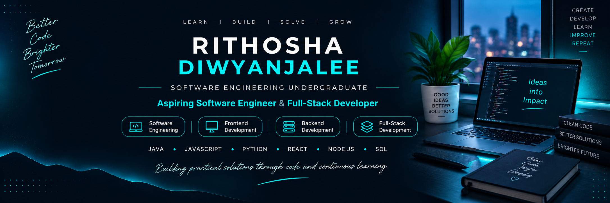

  

  <h1> Hi 👋, <b> I’m RITHOSHA DIWYANJALEE</b> </h1>

<!-- ASPIRING + ANIMATED ROLE : SAME LINE -->

  

    <strong>🚀 Aspiring  </strong> &nbsp;&nbsp;&nbsp; 
  

   &nbsp;&nbsp;&nbsp;&nbsp;
   &nbsp;&nbsp;&nbsp;&nbsp;
   
  
   

 

---

<h2>👩‍💻 &nbsp; About Me</h2>

I'm <b>Rithosha Diwyanjalee</b>, a Software Engineering undergraduate at the <b>Open University of Sri Lanka (OUSL)</b>, passionate about designing and developing practical, efficient and user friendly software solutions.

I enjoy exploring modern technologies, solving real world problems and transforming ideas into working applications.

- 🎓 Pursuing a **Bachelor of Software Engineering (Hons)** at OUSL.
- 💻 Interested in **Software Engineering, Full Stack, Frontend & Backend Development**.
- 🚀 Building **Web, Desktop and Mobile Applications**.
- 🤖 Exploring **AI Integration and Intelligent Software Solutions**.
- 🧠 Passionate about **Problem Solving, Algorithms and Continuous Learning**.
- 🎯 Open to **Software Engineering and Development Internship Opportunities**.

---

<h2>⚡ &nbsp; Technical Skills & Technologies</h2>

  <table>
    <tr>
      <td align="center" width="50%">
        <h3>💻 Programming Languages</h3>
        
          
        
      </td>
      <td align="center" width="50%">
        <h3>🎨 Frontend Development</h3>
        
          
        
        
      </td>
    </tr>
    <tr>
      <td align="center" width="50%">
        <h3>⚙️ Backend Development</h3>
        
          
        
        
        
      </td>
      <td align="center" width="50%">
        <h3>🗄️ Databases</h3>
        
          
        
        
      </td>
    </tr>
    <tr>
      <td align="center" width="50%">
        <h3>☁️ APIs & Cloud</h3>
        
          
        
        
      </td>
      <td align="center" width="50%">
        <h3>🛠️ Development Tools</h3>
        
          
        
        
        
        
        
      </td>
    </tr>
  </table>

  <h3>🧠 Core Concepts & Soft Skills</h3>

  
  
  
  
  
  

---

<h2>🚀 &nbsp; Featured Projects</h2>

A collection of projects that reflect my technical skills, creativity and interest in solving real-world problems.

<table>
  <tr>
    <td width="50%" valign="top">
      <h3>📚 AcadeNex</h3>
      <b>AI-Powered Academic Productivity Platform</b>
        
      A full-stack platform designed to help students manage modules, tasks, deadlines, notes and academic progress with AI-assisted study planning.
        
      
      
      
      
        
      <a href="https://rithosha-portfolio.vercel.app/"><b>↗ Explore Project</b></a>
    </td>
    <td width="50%" valign="top">
      <h3>💬 InquiryFlow</h3>
      <b>Customer Inquiry Management System</b>
        
      A web-based application that simplifies customer inquiry management with authentication, filtering and duplicate detection.
        
      
      
      
        
      <a href="https://rithosha-portfolio.vercel.app/"><b>↗ Explore Project</b></a>
    </td>
  </tr>
  <tr>
    <td width="50%" valign="top">
      <h3>📱 Scorer's Helper</h3>
      <b>Android Cricket Scoring Application</b>
        
      An Android-based application for cricket scoring and match management, including venue navigation and weather information.
        
      
      
      
        
      <a href="https://rithosha-portfolio.vercel.app/"><b>↗ Explore Project</b></a>
    </td>
    <td width="50%" valign="top">
      <h3>🏪 Retail Shop Management System</h3>
      <b>Desktop Business Management Application</b>
        
      A JavaFX desktop application for managing inventory, suppliers, orders, purchases, sales and payments with role-based access control.
        
      
      
      
        
      <a href="https://rithosha-portfolio.vercel.app/"><b>↗ Explore Project</b></a>
    </td>
  </tr>
  <tr>
    <td width="50%" valign="top">
      <h3>🛒 Supermarket Checkout Simulation</h3>
      <b>Performance Modeling & Simulation</b>
        
      A discrete-event simulation designed to analyze checkout queues, customer waiting times, system throughput and service efficiency.
        
      
      
        
      <a href="https://rithosha-portfolio.vercel.app/"><b>↗ Explore Project</b></a>
    </td>
    <td width="50%" valign="top">
      <h3>📖 Vidura BookNest</h3>
      <b>Library Management System</b>
        
      A database-driven application supporting book records, member management, searching, filtering and reservations.
        
      
      
      
        
      <a href="https://rithosha-portfolio.vercel.app/"><b>↗ Explore Project</b></a>
    </td>
  </tr>
</table>

  

---

<h2>🏆 &nbsp; Hackathons & Achievements</h2>

<table align="center">
  <tr>
    <td width="50%" valign="top">
      <h3>🥇 CodeRally 7.0</h3>
      
      
      
National Competitive Programming Hackathon

      IEEE CS SBC, IIT
    </td>
    <td width="50%" valign="top">
      <h3>🏅 MoraXtreme 11.0</h3>
      
      
      
South Asian Algorithmic Programming Competition

      IEEE, University of Moratuwa
    </td>
  </tr>
  <tr>
    <td width="50%" valign="top">
      <h3>🌍 ICPC Sri Lanka 2026/27</h3>
      
      
      
International Collegiate Programming Contest

      Sri Lanka
    </td>
    <td width="50%" valign="top">
      <h3>🏆 AlgoArena</h3>
      
      
      
Inter-University Mobile App Development Competition

    </td>
  </tr>
  <tr>
    <td colspan="2" valign="top">
      <h3>💻 CodeRally 6.0</h3>
      
      
      
National Competitive Programming Hackathon

      IEEE CS SBC, IIT
    </td>
  </tr>
</table>

---

<h2>📜 &nbsp; Professional Certifications</h2>

<table align="center">
  <tr>
    <td width="50%">
      <b>✅ Version Control</b>
       Meta
    </td>
    <td width="50%">
      <b>✅ Introduction to Front-End Development</b>
       Meta
    </td>
  </tr>
  <tr>
    <td>
      <b>✅ Programming with JavaScript</b>
       Meta
    </td>
    <td>
      <b>✅ Introduction to AI</b>
       Google
    </td>
  </tr>
  <tr>
    <td>
      <b>✅ Python for Beginners</b>
       Centre for Open & Distance Learning, University of Moratuwa
    </td>
    <td>
      <b>✅ Data Science Foundation</b>
       Great Learning Academy
    </td>
  </tr>
</table>

---

<h2>📊 &nbsp; GitHub Statistics & Activity</h2>

  
  

    

  

    

  <h3>📈 Contribution Activity</h3>

  

---

<h2>🤝 &nbsp; Let's Connect</h2>

  <h2>Let's Build Something Amazing Together!</h2>

  

    Have an interesting idea, project, or opportunity?
    I'm always excited to connect, collaborate, and
    create meaningful software solutions.
  

  

  
    &nbsp;&nbsp;&nbsp;

  
    &nbsp;&nbsp;&nbsp;

  

  

  

    
  

  

  <h3>✨ Learn &nbsp; • &nbsp; Build &nbsp; • &nbsp; Solve &nbsp; • &nbsp; Grow ✨</h3>

  

    
      Designed with 💙 by <b>Rithosha Diwyanjalee</b>
    
  

